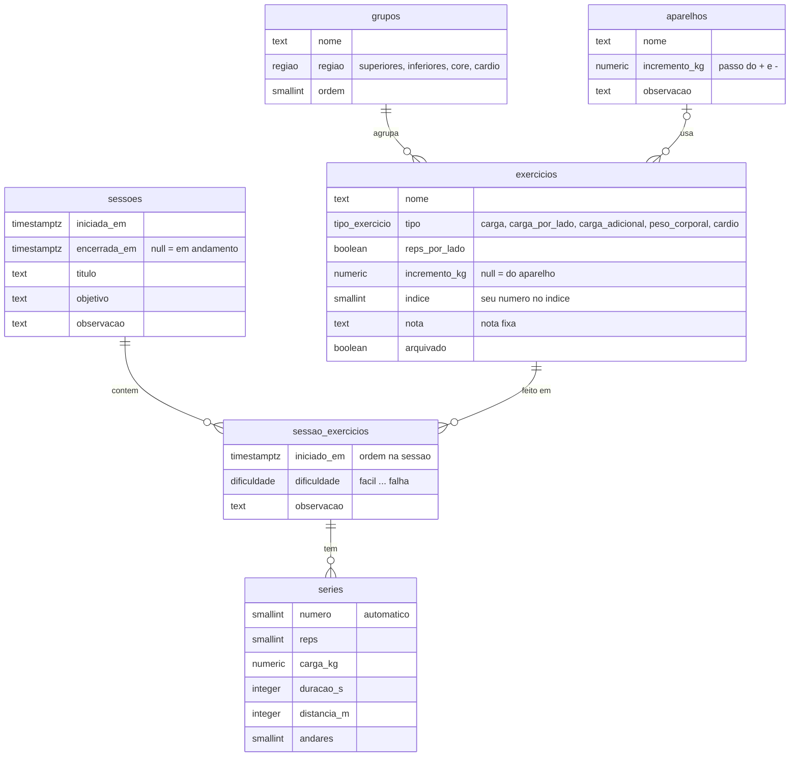

# Treino — plano do app

> Proposta para revisão · 11/10/2026
> Base: seu log de 37 sessões (05/04 → 04/10/2026)

## 1. Objetivo

Um app de celular para registrar o treino **durante** o treino, com o mínimo de toques:

1. **Iniciar sessão** ao chegar na academia.
2. Navegar pelos exercícios por tipo, vendo a última execução de cada um.
3. Registrar cada exercício série a série, com botões **+ / −** para reps e carga.
4. **Encerrar sessão** no fim.
5. Consultar as sessões anteriores.

## 2. Decisões tomadas

| Tema | Decisão |
|---|---|
| Montagem da sessão | **Livre.** A sessão começa vazia e você escolhe os exercícios no catálogo. Sem rotinas nem planejamento na v1. |
| Próxima carga | **Sem recomendação.** O app mostra a última execução e usa os valores dela para preencher os campos. |
| Plataforma | **PWA** (app web instalável na tela inicial do celular). |
| Conexão | **Online.** Grava direto no Supabase, sem modo offline. |
| Banco | **Postgres no Supabase**, com Auth e RLS (cada usuário só vê os próprios dados). |

## 3. O que o seu log ensinou

| No log | Consequência no app |
|---|---|
| 311 linhas de exercício em 37 sessões, ~8 por sessão | A navegação precisa ser rápida. O que já foi feito hoje fica no topo. |
| Reps mudam entre séries em 67 linhas (~1 em 4): `12+10+8`, `15+15+10` | Registro **série a série**, não "3×12". O resumo `12+10+8` é calculado. |
| A carga também muda entre séries às vezes: `25 kg + 30 kg (última série)` | Cada série tem a sua carga. |
| Quatro jeitos de anotar carga: `30 kg`, `15 kg/lado` (58 linhas), `+50 kg` (29 linhas), `15 kg total` | Cada exercício tem um **tipo de carga** que define como o número aparece. O app escreve do jeito que você já escreve. |
| 9 linhas com reps por lado: `6/perna`, `10+8+6/lado` | Opção "reps por lado" no exercício. |
| Dificuldade: Difícil 156×, Na medida 122×, Fácil 8×, Até a falha 3×, Muito difícil 1× | Escala de 5 níveis, marcada **uma vez por exercício** (não por série), com fácil acesso a "Na medida" e "Difícil". |
| Cada aparelho sobe de um jeito: Extensora de 10 em 10, halteres de 1 em 1, cabo de 5 em 5, chest press 14 → 15 → 16 kg/lado | O passo do **+ / −** de carga vem do aparelho, com ajuste por exercício. |
| 80 nomes diferentes para ~54 exercícios (`Puxada alta`, `Puxada aberta`, `Puxada alta (pegada aberta)`…) | **Catálogo fixo**: você escolhe da lista em vez de digitar o nome. |
| Só 7 dos 54 exercícios aparecem na 1ª sessão; os outros 47 foram estreando ao longo dos meses (⭐) | Criar exercício novo **no meio da sessão**, com poucos campos. |
| Avisos que valem por muitas sessões: `⚠️ virilha`, assimetria D/E, "lado E limitante" | **Nota fixa** no exercício, sempre visível na tela de log. |
| Observações do dia: "ajuste de pegada", "caiu na última" | Observação livre no exercício da sessão. |
| Correções depois do treino ("foi 35 kg, não 20 kg") | Sessões passadas podem ser **editadas**. |
| Cardio em 12 sessões: tempo + distância (corrida), tempo + andares (climbmill), protocolo de intervalos | Exercícios do tipo cardio, no mesmo fluxo dos outros. |
| Ordem "livre", "pelo índice" ou "por bloco de aparelho" | Navegar por grupo **ou** por aparelho, ordenando pelo número do seu índice. |
| Título e objetivo da sessão ("Treino Inferiores", "Reativação após 27 dias") | Campos opcionais, preenchidos ao encerrar. |
| 17 "Não realizado" | Na sessão livre só existe o que foi feito. Na importação, eles viram uma linha na observação da sessão. |

## 4. Fluxos e telas

### 4.1 Início

- Sem sessão aberta: botão grande **Iniciar sessão** e, abaixo, "último treino há N dias" e as últimas sessões.
- Com sessão aberta: **Continuar sessão**, com o tempo decorrido. Se a sessão foi aberta há mais de 6 h, o app pergunta se você quer encerrá-la (caso tenha esquecido de fechar).

### 4.2 Sessão em andamento (navegação)

```
Sessão · 00:42                          [Encerrar]
──────────────────────────────────────────────────
Feitos hoje:  Leg press 45° ✓    Flexora ✓
──────────────────────────────────────────────────
[Superiores] [Inferiores] [Core] [Cardio]
Agrupar por: (Grupo)  Aparelho            [Buscar]
──────────────────────────────────────────────────
QUADRÍCEPS
  #1 Leg press 45°                               ✓
     27/09 · 3×12 · +60 kg · Difícil
  #3 Extensora
     04/10 · 3×10 · 57 kg · Difícil
POSTERIOR
  #4 Flexora                                     ✓
     04/10 · 3×10 · 57 kg · Difícil
…
[+ Novo exercício]
```

- **Abas por região** (Superiores · Inferiores · Core · Cardio). Dentro de cada aba, seções por grupo (Peito, Costas…), ordenadas pelo seu índice.
- **Agrupar por aparelho** (Cross Cable, Halteres, Leg press…) para os treinos por bloco.
- **Busca** por nome.
- Cada linha mostra a **última execução** em uma linha curta. O que já foi feito hoje ganha ✓ e aparece em "Feitos hoje".
- **+ Novo exercício**: nome, grupo, aparelho e tipo de carga. Depois de criado, já abre para registrar.

### 4.3 Log do exercício (a tela principal)

```
← Sessão                                    00:42
Flexora
Extensora/Flexora · passo 10 kg
Última vez · 04/10, há 7 dias        ← menor, cinza
3×10 · 57 kg · Difícil
──────────────────────────────────────────────────
SÉRIE 3                      última vez: 10 × 57

   REPS       [ − ]       10       [ + ]

   CARGA      [ − ]     57 kg      [ + ]

            [   Registrar série 3   ]
──────────────────────────────────────────────────
HOJE
   1   10 × 57 kg                          editar
   2   10 × 57 kg                          editar
──────────────────────────────────────────────────
COMO FOI?
   Fácil · Na medida · [Difícil] · Muito difícil · Falha
   Observação (opcional)
            [   Concluir exercício   ]
```

Regras:

- **Valores iniciais.** A 1ª série começa com os valores da 1ª série da última vez. As séries seguintes começam iguais à série que você acabou de registrar. Exercício sem histórico começa com 12 reps e a carga em branco.
- **+ / −.** Reps andam de 1 em 1. A carga anda no passo do exercício (10 kg na Extensora, 1 kg nos halteres…). Tocar no número abre o teclado numérico para valores fora do passo, como os 23 kg da máquina que não tem 20.
- **Registrar série** grava na hora e já deixa a próxima série com os mesmos valores. No caso comum, é **um toque por série**.
- **Hoje.** As séries registradas ficam listadas. Tocar numa delas permite corrigir ou apagar.
- **Última vez**, em letra menor e cor neutra: data, há quantos dias, séries, dificuldade e observação. Ao lado de cada série aparece o valor da mesma série na última vez.
- **Nota fixa** do exercício (ex.: ⚠️ virilha) aparece no topo, em destaque.
- **Concluir.** Você marca a dificuldade e, se quiser, uma observação, e volta para a navegação.
- **Cardio.** Os controles viram duração (min), distância (km) e, no climbmill, andares.

Formatos de exibição:

| Tipo do exercício | Carga | Reps por lado |
|---|---|---|
| `carga` | `57 kg` | `10/lado`, ou `10/perna` nos inferiores |
| `carga_por_lado` | `15 kg/lado` | idem |
| `carga_adicional` | `+60 kg` | idem |
| `peso_corporal` | — | idem |
| `cardio` | `30 min · 3,54 km` ou `20 min · 46 andares` | — |

Resumo das séries: se todas são iguais, `3×12 · 30 kg`. Se as reps variam, `12+10+8 · 30 kg`. Se a carga varia, `12×25 + 12×25 + 10×30`.

### 4.4 Encerrar sessão

- Resumo com a duração e os exercícios feitos, cada um com suas séries.
- Título sugerido pelas regiões treinadas (Superiores, Inferiores ou Misto, mais "+ Cardio" se houver), que você pode editar. Objetivo e observação são opcionais.
- Ao confirmar, a sessão é encerrada.

### 4.5 Consulta

- **Sessões**: lista com data, título, duração e número de exercícios. Tocar abre o detalhe no formato da tabela do seu log. Tudo é editável: corrigir carga, apagar série, adicionar um exercício esquecido.
- **Histórico do exercício**: aberto pela tela de log ("ver histórico") ou pelo catálogo, com todas as execuções da mais recente para a mais antiga.

### 4.6 Catálogo

- **Exercício**: nome, grupo, aparelho, tipo de carga, reps por lado, passo, índice e nota fixa. Um exercício **arquivado** some da navegação, mas o histórico dele continua guardado.
- **Aparelho**: nome, passo e observação (ex.: "vai até 100 kg, de 10 em 10").

## 5. Modelo de dados

Arquivos:

- [`supabase/migrations/20261011120000_schema_inicial.sql`](../supabase/migrations/20261011120000_schema_inicial.sql): tabelas, RLS, triggers e views.
- [`supabase/migrations/20261011120100_catalogo_inicial.sql`](../supabase/migrations/20261011120100_catalogo_inicial.sql): função `seed_catalogo` com o catálogo da seção 6.



Escolhas principais:

- **Uma linha por série** (`series`), porque em ~1 de cada 4 exercícios as séries são diferentes entre si.
- **`carga_kg` é o número que você lê no aparelho.** O `tipo` do exercício diz como lê-lo (total, por lado ou adicional). A v1 não calcula volume.
- **Dificuldade e observação ficam no exercício da sessão**, como no log.
- **Sessão em andamento** é a que tem `encerrada_em` vazio. O banco garante que só existe uma de cada vez.
- **Voltar a um exercício** na mesma sessão continua o mesmo registro (`unique (sessao_id, exercicio_id)`).
- **O número da série é automático**, e apagar uma série renumera as seguintes (via triggers).
- **RLS** em todas as tabelas (`user_id = auth.uid()`). As views usam `security_invoker`, então respeitam o RLS.

Views para o app:

| View | Uso |
|---|---|
| `v_catalogo` | Tela de navegação: exercício + grupo + aparelho + passo + última execução. |
| `v_ultima_execucao` | Última vez de cada exercício, só de sessões **encerradas** (a sessão de hoje não conta). |
| `v_execucoes` | Cada exercício feito, com as séries em arrays (`reps = {12,10,8}`). Serve o detalhe da sessão e o histórico do exercício. |
| `v_sessoes` | Lista de sessões com duração, número de exercícios e regiões. |

O que cada tela lê e grava:

| Tela | Lê | Grava |
|---|---|---|
| Início | `sessoes` em andamento, `v_sessoes` (últimas) | `insert sessoes` |
| Navegação | `v_catalogo`, exercícios da sessão atual | — |
| Log | `v_catalogo` (1 linha), séries de hoje | upsert em `sessao_exercicios` só ao registrar a 1ª série (abrir e sair não cria registro vazio); insert, update e delete em `series`; dificuldade e observação |
| Encerrar | `v_execucoes` da sessão | `update sessoes` (encerrada_em, título…) |
| Consulta | `v_sessoes`, `v_execucoes` por sessão ou por exercício | updates de correção |

**Testado** em Postgres 16 local, com stubs de `auth.users`, `auth.uid()` e dos roles do Supabase. Usando as sessões 35 e 37 do log, foi verificado que:

- as migrações aplicam sem erro;
- o seed roda duas vezes sem duplicar nada;
- as séries são numeradas e renumeradas sozinhas;
- a última vez ignora a sessão aberta;
- o banco recusa uma segunda sessão aberta;
- outro usuário não vê nem grava nada que não seja dele;
- o app (anon ou authenticated) não consegue chamar o seed.

## 6. Catálogo inicial (55 exercícios)

Consolidado dos 80 nomes do log, com as equivalências confirmadas por você (seção 11). Os passos de carga por aparelho foram inferidos das cargas usadas e podem ser ajustados no app.

| Grupo | Exercício | Aparelho | Carga | Como aparecia no log |
|---|---|---|---|---|
| Peito | Supino máquina | Chest press | kg/lado | |
| | Voador (peck deck) | Voador | kg | |
| | Supino inclinado com halteres | Halteres | kg/lado | Supino inclinado (halteres) |
| | Crucifixo no cabo | Cross Cable | kg/lado | Crucifixo no cabo (cross), Crucifixo (cabo) |
| | Supino com halteres | Halteres | kg/lado | |
| | Crucifixo com halteres | Halteres | kg/lado | Crucifixo |
| | Voador no cabo (fly lateral) | Cross Cable | kg | |
| Costas | Puxada alta (pegada aberta) | Polia alta | kg | Puxada alta, Puxada aberta |
| | Puxada alta (pegada supinada) | Polia alta | kg | Puxada supinada |
| | Puxada alta (corda) | Cross Cable | kg | Puxada alta (com corda) |
| | Remada baixa (triângulo) | Remada sentada | kg | Remada baixa cabo, Remada baixa cabo (triângulo), Remada triângulo |
| | Remada baixa (barra) | Remada sentada | kg | Remada baixa cabo (barra) |
| | Remada baixa (pegada supinada) | Remada sentada | kg | #28, citada nas notas da S36; sem execução no log |
| | Remada curvada | Barra livre | kg | |
| Ombros | Elevação lateral (cabo) | Cross Cable | kg | Elevação lateral |
| | Elevação frontal (cabo) | Cross Cable | kg/lado | Elevação frontal no cabo |
| | Crucifixo inverso (cabo) | Cross Cable | kg/lado | Crucifixo inverso/posterior no cabo / (cabo) |
| | Desenvolvimento sentado (halteres) | Halteres | kg/lado | Desenvolvimento |
| | Voador no cabo bilateral | Cross Cable | kg | Voador no cabo bilateral (fly lateral) |
| | Face pull (cabo) | Cross Cable | kg | |
| Bíceps | Rosca com barra (cabo baixo) | Cross Cable | kg | Rosca bíceps com barra (cabo baixo), Rosca com barra (cabo), Rosca bíceps (cabo baixo) |
| | Rosca na corda (cabo baixo) | Cross Cable | kg | Rosca bíceps na corda (cabo baixo) |
| | Rosca por trás (cabo baixo) | Cross Cable | kg/lado | Rosca bíceps por trás (cabo baixo) |
| | Puxada triângulo (bíceps) | Cross Cable | kg | |
| | Rosca martelo | Halteres | kg/lado | Rosca martelo alternado |
| | Rosca martelo cruzada | Halteres | kg, reps/lado | Rosca martelo cruzada (halteres), … alternada, Rosca bíceps cruzada (halteres) |
| | Rosca alternada (halteres) | Halteres | kg/lado | |
| | Rosca inclinada (halteres) | Halteres | kg/lado | Rosca bíceps inclinada (halteres), Rosca inclinada |
| | Rosca com barra (livre) | Barra livre | kg | Rosca bíceps com barra (com aparelho "Barra + anilhas") |
| Tríceps | Tríceps corda | Cross Cable | kg | |
| | Tríceps pushdown com barra | Cross Cable | kg | Tríceps pushdown com barra (cabo), Tríceps pushdown c/ barra |
| | Tríceps francês (cabo) | Cross Cable | kg | |
| | Tríceps unilateral (cabo) | Cross Cable | kg | Tríceps unilateral no cabo · nota: assimetria D/E |
| | Tríceps francês (halter) | Halteres | kg | Tríceps francês |
| Quadríceps | Leg press 45° | Leg press | +kg | |
| | Extensora | Extensora/Flexora | kg | |
| | Extensora unilateral | Extensora/Flexora | kg, reps/perna | Extensora (unilateral alternada) |
| | Afundo búlgaro | Halteres | kg/lado, reps/perna | |
| | Agachamento sumô | Halteres | kg | · nota: ⚠️ virilha |
| | Agachamento livre | Barra livre | kg | |
| Posterior | Flexora | Extensora/Flexora | kg | |
| | Stiff | Barra livre | kg | |
| Glúteos | Elevação pélvica (hip thrust) | Máquina de hip thrust | kg | |
| | Coice no cabo | Cross Cable | kg | Coice no cabo (glúteo) |
| Adutores | Adução | Cadeira adutora | kg | Adução (fechar) |
| Abdutores | Abdução | Cadeira abdutora | kg | Abdução (abrir) |
| | Abdução no cabo | Cross Cable | kg | Abdução no cabo (perna) · nota: lado E limitante |
| Panturrilha | Panturrilha no leg press | Leg press | +kg | Panturrilha (leg press), Panturrilha (bilateral) |
| | Panturrilha unilateral no leg press | Leg press | kg/lado, reps/perna | Panturrilha (unilateral) |
| | Panturrilha na máquina | Máquina de panturrilha | kg | Panturrilha (máquina) |
| Estabilização | Saltos pausados unilaterais | Mini trampolim | reps/perna | Saltos pausados (unilateral) |
| Abdômen | Abdominal na máquina | Máquina de abdominal | kg | Abdominal (máquina) |
| | Crunch com anilha | Anilha (solo) | kg | |
| Cardio | Corrida | Esteira | tempo, distância | Corrida/Caminhada |
| | Climbmill | Climbmill | tempo, andares | |

Números do índice já preenchidos (dos que aparecem nas sessões 31–37): inferiores 1–9; superiores 1, 2, 3, 5, 14–22, 25 e 28–32.

## 7. Importação do histórico

O script [`scripts/importar_log.py`](../scripts/importar_log.py) (Python, sem dependências) lê o log guardado em [`docs/referencia/treino_log.md`](referencia/treino_log.md) e gera [`supabase/importacao/historico.sql`](../supabase/importacao/historico.sql), que grava as 37 sessões. Assim, a "última vez" já funciona no primeiro treino com o app.

Para regenerar depois de mudar o log ou as regras: `python3 scripts/importar_log.py`.

Regras de conversão:

- **Cabeçalho** `## Sessão N — DD/MM/AAAA | Título | ~50 min` → data, título e duração. A hora não está no log, então fica 12:00 (horário de Brasília). Sem duração, a sessão começa e termina no mesmo instante.
- **Texto da sessão.** `**Objetivo:**` vai para `objetivo`. `**Ordem:**`, as notas `> 📝` / `⚠️` / `⭐` e os "Destaques" vão para `observacao`.
- **Nome** → exercício do catálogo, pela coluna "Como aparecia no log". Nos casos ambíguos, a coluna Aparelho decide (ex.: "Rosca bíceps com barra" com "Barra + anilhas" vs. "Cross Cable").
- **Séries e reps:**

  | No log | Vira |
  |---|---|
  | `3` + `12` | 12, 12, 12 |
  | `12+10+8` | 12, 10, 8 |
  | `3x12` | 12, 12, 12 |
  | `2x10+1x8` | 10, 10, 8 |
  | `6/perna`, `10+8+6/lado` | reps por lado |
  | `8-10` com séries `2x10+1x8` | 10, 10, 8 |
  | `decrescente` com séries `12+10+8` | 12, 10, 8 |
  | `3x5~8` (S36) | 5, 5, 5, com "entre 5 e 8 reps" na observação |

- **Carga:** `+40 kg` → 40; `14 kg/lado (28 kg total)` → 14; `15 kg total` → 15. `2+1` com `25 kg + 30 kg (última série)` → duas séries de 25 e uma de 30. Supino máquina S1–S4: `20 kg` era o total → 10 kg/lado.
- **Dificuldade.** O começo do texto vira o nível, e o resto vai para a observação: `Difícil (caiu na última)` → difícil + "caiu na última". `Irregular`, `Pirâmide` e `Interrompido (…)` ficam sem nível, com o texto na observação.
- **"Não realizado"** não gera registro. Esses nomes entram na observação da sessão ("Não realizados: Stiff").
- **Cardio.** Duração, distância e andares viram uma série de Corrida ou Climbmill. O protocolo de intervalos vai para a observação.
- **"Próxima Carga Recomendada"** é descartada, porque o app não terá recomendação. Só dois trechos com fato vão para a observação do exercício: a correção da Extensora (S11, 35 → 37 kg) e "máquina não tinha 20 kg" (S13). As estreias já estão nas notas da sessão.
- **Formatos diferentes.** A sessão 36 tem as colunas em outra ordem (Grupo, Carga antes de Reps, `3x12`), e a 9 tem uma tabela própria. As duas são tratadas à parte. A rosca com barra da S37, que só aparece nas notas, entra como exercício feito (3×10, 5 kg, difícil).
- **Conferência.** O SQL termina mostrando as contagens: **37 sessões, 307 exercícios** (294 da tabela + 12 de cardio + 1 das notas da S37) e **898 séries**.
- **Segurança.** O SQL cancela tudo se houver mais de um usuário ou se já existirem sessões, então rodar duas vezes não duplica nada. Ele também roda o seed do catálogo.
- **Testado** em Postgres 16 local nos dois caminhos (com e sem seed rodado antes). A "última vez" de 13 exercícios bateu com o log, ex.: Leg press 04/10 3×10 +60 kg; Supino 02/10 12+10+10 · 20 kg/lado; Agachamento sumô 23/08 12+10+0.

## 8. Stack e arquitetura

- **Front:** Vite + React + TypeScript. PWA via `vite-plugin-pwa` (manifest, ícone, modo standalone). Tailwind e React Router.
- **Dados:** `supabase-js` com TanStack Query. A série aparece na tela na hora e é gravada em segundo plano. Se a gravação falhar, aparece um aviso com "tentar de novo".
- **Tipos:** gerados do banco com `supabase gen types typescript`.
- **Login:** e-mail + **código de 6 dígitos** (OTP), não link mágico. No iPhone, o PWA instalado não divide o login com o Safari, então o link abriria no lugar errado. O login fica salvo, então você entra uma vez só.
- **Hospedagem:** Vercel, no plano gratuito, com deploy a cada push na `main`.
- **Interface:** feita para o celular. Botões de ≥ 56 px, números grandes, tema escuro e ações principais na metade de baixo da tela, para usar com uma mão.
- **Fuso:** datas exibidas em `America/Sao_Paulo`.

Estrutura proposta:

```
src/
  pages/        Inicio, Sessao, LogExercicio, EncerrarSessao,
                Sessoes, SessaoDetalhe, ExercicioHistorico, Catalogo
  components/   Stepper, ChipsDificuldade, ResumoSeries, UltimaVez, …
  lib/          supabase.ts, queries.ts, formato.ts  ("12+10+8 · 57 kg", "+60 kg", "/perna")
scripts/        importar_log.py
supabase/
  migrations/
docs/
```

## 9. Fases

| Fase | Entrega | Pronto quando |
|---|---|---|
| **0. Banco** ✅ | Schema, RLS, views, catálogo, testes locais | Feito |
| **1. Supabase + histórico** ⏳ | Criar o projeto, aplicar as migrações, criar o usuário, rodar o seed e importar as 37 sessões | `v_catalogo` mostra a última vez correta nos exercícios conferidos |
| **2. Registro (MVP)** | PWA com login, iniciar e continuar sessão, navegação, tela de log, novo exercício, concluir e encerrar | Um treino real inteiro registrado só pelo app |
| **3. Consulta e edição** | Lista e detalhe de sessões, edição, histórico por exercício, catálogo editável | Corrigir um erro de uma sessão passada pelo app |
| **4. Extras** | Backlog abaixo, por ordem de valor | — |

Backlog (fase 4):

1. **Exportar sessão em Markdown** no formato do log atual, para continuar analisando com o Claude.
2. Gráfico de evolução por exercício.
3. Recordes automáticos: 🏆 maior carga, 🎉 "fechou 3×12".
4. Timer de descanso entre séries.
5. Tela sempre acesa durante a sessão (Wake Lock).
6. Séries por lado (D/E), para acompanhar as assimetrias.
7. Rotinas salvas (Superiores / Inferiores).

## 10. Fora da v1

- **Recomendação de carga** (decidido).
- **Rotinas e planejamento** (decidido: sessão livre). O modelo aceita rotinas depois sem mudar as tabelas atuais.
- **Modo offline** (decidido: a internet na academia é boa).
- **Volume/tonelagem.** Com `kg/lado`, `+kg` e reps por lado, essa conta engana fácil. Fica para quando houver gráficos.

## 11. Revisão do log

Decidido com você (11/10):

- **Supino máquina S1–S4:** `20 kg` era o total → importado como 10 kg/lado.
- **Viram um exercício só:** "Rosca bíceps (cabo baixo)" = Rosca com barra (cabo baixo); "Rosca bíceps cruzada (halteres)" = Rosca martelo cruzada; "Desenvolvimento" = Desenvolvimento sentado (halteres).
- **"Rosca martelo alternado"** (S21) = Rosca martelo.
- **"Remada pegada supinada" (#28)** é outro exercício, diferente da Remada baixa (barra). Entrou no catálogo pela migração `20261011150000_remada_supinada.sql`.
- **O log fica no repositório**, em `docs/referencia/treino_log.md`.

Ainda em aberto (nada disso bloqueia a importação; tudo dá para ajustar depois):

1. **Índice completo:** só estão preenchidos os números que aparecem nas sessões 31–37. Na S36, Rosca martelo e Puxada aberta aparecem as duas como #24, então ficaram sem número.
2. **Abdução na S6** aparece no aparelho "Cadeira adutora", com 15 kg. É a mesma máquina da "Cadeira abdutora" usada depois (35–57 kg)?
3. **Passos de carga:** os da adutora (2,5 kg) e da máquina de abdominal (2,5 kg) foram chute (o log tem 20 → 22 → 25 → 28 e 27 → 30).
4. **Voador no cabo unilateral:** na S36 só o bilateral foi para Ombros. O unilateral ficou em Peito.

## 12. Como aplicar o banco

1. Crie um projeto no Supabase.
2. Aplique as migrações de `supabase/migrations/`, em ordem. Escolha um caminho:
   - **SQL Editor:** cole e rode cada arquivo.
   - **CLI:** `supabase init` (mantém a pasta `migrations`), `supabase link --project-ref <ref>` e `supabase db push`.
3. Crie o seu usuário em *Authentication → Users → Add user*.
4. No SQL Editor, rode `supabase/importacao/historico.sql`. Ele roda o seed do catálogo e importa as 37 sessões.

Sem importar o histórico, o passo 4 vira `select public.seed_catalogo('<seu user id>');`.
